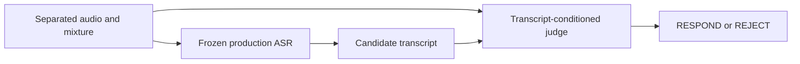

# Action model

The current model uses `action_judge_v1`, with checkpoint metadata version 3.
It predicts RESPOND or REJECT from paired audio and a candidate transcript.
Training updates a judge adapter and protocol-token rows. Production transcription weights remain frozen.

## Script index and setup

Run commands from the repository root in an environment with `requirements.txt` installed.

| Entry point | Purpose | Inputs and outputs |
|---|---|---|
| [`scripts/prepare_judge_manifest.py`](../scripts/prepare_judge_manifest.py) | Label production transcripts for judge training | Source manifest and verified candidates to a labeled JSONL and `.meta.json` sidecar |
| [`scripts/finetune_judge.sh`](../scripts/finetune_judge.sh) | Launch frozen-production judge training | Base model, production adapter, and prepared train/validation manifests to judge checkpoints and `train.log` |
| [`tests/eval_checkpoint.py`](../src/MegaASR/A2S-SFT/tests/eval_checkpoint.py) | Shared ASR and action evaluation command | Checkpoint and validation manifest to prediction JSONL and summary JSON |
| [`eval_judge.py`](../src/MegaASR/A2S-SFT/eval_judge.py) | Direct entry point for the current judge evaluator | Judge checkpoint and manifest to `persample.jsonl` and `summary.json` in an output directory |
| [`tests/eval_action_checkpoint.py`](../src/MegaASR/A2S-SFT/tests/eval_action_checkpoint.py) | Compatibility evaluator for `action_first` and `action_special_v1` checkpoints | Called by the shared evaluator for those formats; the current judge uses `eval_judge.py` |

Evaluator paths in the table are relative to `src/MegaASR/A2S-SFT` unless they start with `scripts/`.
The files under `tests/` in this table are evaluation commands, not smoke-test harnesses.
Commands for the primary entry points appear in the labeling, training, and evaluation sections below.

Set these paths before labeling or training:

```bash
export BASE_MODEL_PATH=/path/to/Qwen3-ASR-1.7B
export PRODUCTION_CHECKPOINT=/path/to/production/checkpoint
RUN=/path/to/new-run
SOURCE=/path/to/recorded-candidates
mkdir -p "$RUN/manifests"
```

On Hyak, put `RUN` under `/gscratch/intelligentsystems/daniel/results`.
`SOURCE` is needed only when reusing candidate fields stored in existing manifests.
The production checkpoint supplies trained speech parameters; the base model supplies their underlying weights.

Create `$RUN/generation_config.json` with the actual candidate-generation settings.
For the English, early-fusion evaluation command shown below, those settings are:

```json
{
  "do_sample": false,
  "max_new_tokens": 256,
  "language": "English",
  "sample_rate": 16000,
  "use_fusion": true,
  "fusion_type": "early_conv",
  "collator": "none"
}
```

Use recorded settings for existing predictions. Keep unknown settings explicit instead of copying this example as provenance.

## Architecture

The inputs are separated target audio (`audio_sep`) and the original mixture (`audio_mix`).
Both streams use mono audio sampled at 16 kHz.
The separator runs upstream. This code reads existing audio files.



Initialization follows this order:

1. Load the Qwen3-ASR base model and processor.
2. Load and merge the production adapter, including its saved fusion parameters.
3. Register the protocol tokens and initialize their embedding and output rows.
4. Freeze production parameters and install a decoder LoRA for judging.
5. Train the judge LoRA and protocol-token rows.

| Component | Updated during judge training? |
|---|---|
| Audio encoder, fusion, and projection | No |
| Production decoder and base vocabulary matrices | No |
| Judge decoder LoRA | Yes |
| Protocol-token embedding and output rows | Yes |

The judge uses `<|action_query|>` as its input query token.
Its target is `<|action_respond|>` or `<|action_reject|>`.
The target action token is excluded from the input sequence.

### Training

Each batch uses one decoder forward pass with this sequence:

```text
[audio prompt and language prefix] generated_transcription <EOS> <|action_query|>
```

The query attends to audio and candidate tokens.
Cross-entropy loss applies only to the action prediction at the query position.
The loss can weight examples by action class.
Training applies no transcription loss or direct WER loss.
Reference transcripts, WER, and target actions are excluded from model inputs.

The launcher freezes acoustic modules and uses decoder LoRA rank 8, alpha 16, and learning rate `1e-5`.
Protocol rows use learning rate `1e-5` and zero weight decay.
Their fp32 parameters support small updates when model computation uses reduced precision.

### Inference

1. Disable judge LoRA and protocol-row overrides. Generate a transcript with the production processor.
2. Enable the judge. Build a separate context with audio, candidate text, EOS, and query.
3. Predict an action token and parse the result.

Disabling the judge retains the merged production adapter.
Decoder caches are not shared between production and judge modes.
The implementation recalculates acoustic features for the judge context.
Requests that switch modes on one model instance must run sequentially.

Unconstrained decoding selects the highest-scoring token from the full vocabulary.
Invalid actions have an effective action of REJECT.
Pipeline evaluation also rejects transcripts that reach the generation limit without EOS.
Constrained decoding restricts the output to the two action tokens.
It guarantees valid syntax but does not establish decision accuracy.

## Manifests and labels

Prepared judge manifests contain these fields:

```json
{
  "audio_sep": "/path/to/target_sep.wav",
  "audio_mix": "/path/to/mixture.wav",
  "text": "reference transcript",
  "generated_transcription": "recorded production prediction",
  "wer": 0.25,
  "label_wer": 0.25,
  "action": "RESPOND"
}
```

Normalize the reference and candidate with `judge_data.py` before calculating utterance WER.
The target is RESPOND when WER is at most `0.75`; otherwise, it is REJECT.
The reference is used for labeling and evaluation only.
A missing candidate is an error. An empty candidate receives WER against the reference.

Use `scripts/prepare_judge_manifest.py` to label candidates and write a separate manifest with provenance.
It accepts evaluator predictions directly or a source manifest with recorded candidates.
It recalculates WER and writes `wer`, `label_wer`, `generated_transcription`, and `action`.

To label the evaluator's output:

```bash
python scripts/prepare_judge_manifest.py \
  --source /path/to/evaluated/val.jsonl \
  --predictions /path/to/eval/predictions.jsonl \
  --prediction-summary /path/to/eval/summary.json \
  --checkpoint "$PRODUCTION_CHECKPOINT" \
  --generation-config "$RUN/generation_config.json" \
  --output "$RUN/manifests/val_judge.jsonl"
```

Use the same source manifest that the evaluator read, including its audio paths.
The labeler verifies sample indices, references, audio paths, candidate WER, and the summary's checkpoint identity.

Record the production checkpoint, decoding settings, normalization, counts, source history, and checksums.
Reuse recorded production predictions when their provenance supports reuse.
Keep unknown generation settings explicit. Do not infer missing settings from the checkpoint name.

To reuse candidates already stored in source manifests:

```bash
for split in train val; do
  python scripts/prepare_judge_manifest.py \
    --source "$SOURCE/${split}_action.jsonl" \
    --output "$RUN/manifests/${split}_judge.jsonl" \
    --checkpoint "$PRODUCTION_CHECKPOINT" \
    --generation-config "$RUN/generation_config.json"
done
```

`SOURCE` identifies manifests with recorded production hypotheses and checkpoint metadata.
The default candidate field is `label_hypothesis`; override it with `--candidate-field` when needed.
`generation_config.json` contains the verified settings used to create those hypotheses.
Preparation preserves source files and refuses an existing output path.
The sidecar records source and prediction checksums, checkpoint identity, decoding settings, row count, and action counts.

## Training recipe

Export `BASE_MODEL_PATH` and `PRODUCTION_CHECKPOINT`. Set the prepared manifest paths explicitly.
The production checkpoint is a trained speech adapter. The base model supplies its underlying weights.
Use a new persistent run directory and preserve a code snapshot with checksums.

On Hyak, check existing allocations before requesting resources.
Use `salloc` to reserve resources and `srun --ntasks=1 --pty bash -l` to enter the compute-node shell.
Extract datasets and put temporary files and caches in a job-specific directory under `/scr`.
Update working manifests to reference the extracted audio.
Save code snapshots, logs, predictions, manifests, and checkpoints under `/gscratch/intelligentsystems/daniel/results`.
Set `PYTHONDONTWRITEBYTECODE=1` when using a shared environment.

Use 32 balanced training examples and 32 separate balanced validation examples for the initial smoke run:

```bash
TRAIN_JSONL="$RUN/manifests/train_tiny.jsonl" \
VAL_JSONL="$RUN/manifests/val_tiny.jsonl" \
OUT_DIR="$RUN/smoke" NPROC_PER_NODE=1 BATCH_SIZE=2 GRAD_ACC=1 \
EPOCHS=20 SAVE_STEPS=80 ACTION_REJECT_WEIGHT=1 \
bash scripts/finetune_judge.sh
```

This gives 320 optimizer updates with effective batch size 2.
Before full training, require finite losses and gradients, successful reload, and frozen production behavior.
Check constrained and unconstrained evaluation on both subsets.
Require at least 95% valid actions in each evaluation and 75% unconstrained generated-action accuracy on the training subset.
Investigate failed checks before continuing.

Start full training from production weights, with a new judge adapter.
Set dataset paths, epochs, and accumulation explicitly.
A three-epoch recipe with effective batch size 64 uses this command after smoke acceptance:

```bash
TRAIN_JSONL="$RUN/manifests/train_judge.jsonl" \
VAL_JSONL="$RUN/manifests/val_judge.jsonl" \
OUT_DIR="$RUN/checkpoints" NPROC_PER_NODE=1 BATCH_SIZE=2 GRAD_ACC=32 \
EPOCHS=3 SAVE_STEPS=250 ACTION_REJECT_WEIGHT=0 \
bash scripts/finetune_judge.sh
```

`ACTION_REJECT_WEIGHT=0` calculates class weighting from the training manifest.
Effective batch size is GPU count multiplied by per-GPU batch size and gradient accumulation.
For another allocation, adjust these settings together.
The launcher does not enforce smoke acceptance; complete the acceptance checks before running full training.

The launcher requires `BASE_MODEL_PATH`, `PRODUCTION_CHECKPOINT`, `TRAIN_JSONL`, `VAL_JSONL`, and `OUT_DIR`.
The examples set GPU count, batch size, accumulation, epochs, save interval, and class weighting explicitly.
`ACTION_TOKEN_LR` overrides the protocol-row learning rate; `WER_THRESHOLD` overrides the labeling threshold.
Keep `WER_THRESHOLD` consistent with manifest metadata.
To resume, add `RESUME_FROM=/path/to/checkpoint-N` to the same training command's environment.
The output directory contains `train.log`, saved checkpoints, and the final adapter under `final/`.

## Evaluate checkpoints

Use `src/MegaASR/A2S-SFT/tests/eval_checkpoint.py` from the repository root.
It selects ASR or action inference from checkpoint metadata.
It also supports older action checkpoint formats for compatibility.
For a text-format action checkpoint without metadata, set `--task action`.

### Baseline or production ASR

```bash
python src/MegaASR/A2S-SFT/tests/eval_checkpoint.py \
  --checkpoint_dir /path/to/production/checkpoint \
  --base_model_path /path/to/Qwen3-ASR-1.7B \
  --val_file /path/to/val.jsonl \
  --use_fusion 1 --fusion_type early_conv --collator none \
  --language English --sr 16000 --max_new_tokens 256 \
  --out_json /path/to/new-eval/predictions.jsonl \
  --summary_json /path/to/new-eval/summary.json
```

For baseline Qwen, select the base model as `--checkpoint_dir` and set `--use_fusion 0`.
Production fusion reads both audio streams. Baseline Qwen reads separated audio.
Full model checkpoints load directly. Adapter checkpoints also require their base weights.

### Transcript-conditioned judge

```bash
python src/MegaASR/A2S-SFT/tests/eval_checkpoint.py \
  --checkpoint_dir /path/to/judge/final \
  --val_file /path/to/val.jsonl \
  --mode pipeline --decoding_mode unconstrained \
  --max_new_tokens 256 \
  --out_json /path/to/new-eval/predictions.jsonl \
  --summary_json /path/to/new-eval/summary.json
```

Pipeline mode accepts `audio_sep`, `audio_mix`, and reference `text` without prepared candidates or labels.
It calculates WER and the correct action for each generated transcript.
Saved `wer` and `action` fields do not determine these targets.

The checkpoint records the base-model and production-adapter paths.
If those files moved, override them with `--base_model_path` and `--merged_from_lora_path`.
Fusion overrides must match the trained judge configuration.
Use `--mode cached` with a prepared candidate manifest to evaluate fixed production transcripts.
Cached mode validates candidate labels, checkpoint provenance, and the manifest checksum.

The direct judge entry point provides the same judging implementation with an output-directory interface:

```bash
python src/MegaASR/A2S-SFT/eval_judge.py \
  --checkpoint /path/to/judge/final \
  --manifest /path/to/val.jsonl \
  --mode pipeline --decoding-mode unconstrained \
  --max-new-tokens 256 \
  --out-dir /path/to/new-eval
```

This command writes `persample.jsonl` and `summary.json` under `--out-dir`.
Its option names use hyphens. The shared evaluator uses underscore names such as `--decoding_mode`.
For saved candidates, select a prepared manifest and change either command's mode to `cached`.

### Outputs

ASR prediction rows contain `index`, `audio_path`, `ref`, `hyp`, and `wer`.
Judge rows also contain the candidate, parsed action, effective action, validity, and WER-derived target.
ASR summaries record corpus WER, mean utterance WER, and median utterance WER.
Judge summaries additionally record:

- Mean, median, and corpus WER among predicted RESPOND samples.
- Response rate and count.
- Overall action accuracy, generated-action accuracy, action validity, and per-class recall.

Overall action accuracy compares effective decisions with WER-derived targets across all samples.
Generated-action accuracy counts invalid action tokens as incorrect.
Mean utterance WER weights utterances equally. Corpus WER weights reference words equally.
WER values use fractions: `0.25` means 25% WER.
Response WER fields are `null` when no samples are accepted.
Cached evaluation measures filtering of fixed transcripts, not new transcription quality.

## Checkpoint contents

Judge checkpoints contain decoder LoRA weights, tokenizer files, protocol rows, and reconstruction metadata.
Vocabulary matrices expand only when the protocol token IDs exceed their existing dimensions.
The loader validates token mappings, row dimensions, and loaded parameters.
Resuming across different action objectives is rejected.
A judge adapter alone is not a complete model. Loading also requires base and production weights.
Inference requires production and judge adapter modes on the same backbone.

## Implementation modules

The training launcher calls `finetune.py`. The remaining modules below provide shared implementation functions.
They do not require separate shell commands in the labeling, training, or evaluation workflow.

| Module under `src/MegaASR/A2S-SFT` | Responsibility |
|---|---|
| [`arguments.py`](../src/MegaASR/A2S-SFT/arguments.py) | Parse training paths, action objectives, learning rates, and resource-related settings |
| [`finetune.py`](../src/MegaASR/A2S-SFT/finetune.py) | Validate manifests and training configuration, initialize the model, and start training |
| [`dataloader.py`](../src/MegaASR/A2S-SFT/dataloader.py) | Read paired audio and build candidate/query inputs, labels, masks, and example weights |
| [`modeling.py`](../src/MegaASR/A2S-SFT/modeling.py) | Load and merge adapters, manage protocol rows, freeze parameters, and switch inference modes |
| [`trainer.py`](../src/MegaASR/A2S-SFT/trainer.py) | Calculate the selected objective, configure optimizer groups, and save or restore action checkpoints |
| [`checkpointing.py`](../src/MegaASR/A2S-SFT/checkpointing.py) | Find saved training checkpoints and preserve checkpoint-local processor files |
| [`action_format.py`](../src/MegaASR/A2S-SFT/action_format.py) | Define token spellings, output protocols, parsers, and checkpoint metadata validation |
| [`judge_data.py`](../src/MegaASR/A2S-SFT/judge_data.py) | Normalize transcripts, calculate candidate WER, and validate manifest labels and checksums |
| [`judge_inference.py`](../src/MegaASR/A2S-SFT/judge_inference.py) | Judge fixed candidates or run production transcription followed by a separate judge context |

[`requirements.txt`](../requirements.txt) includes the WER and number-normalization dependencies used by labeling and evaluation.
